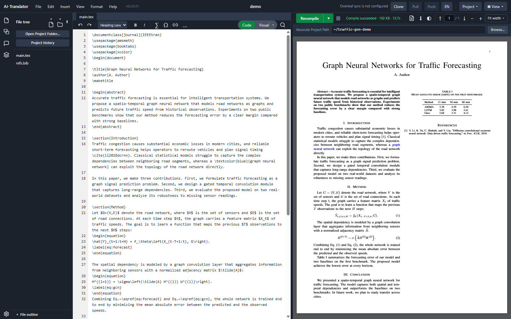
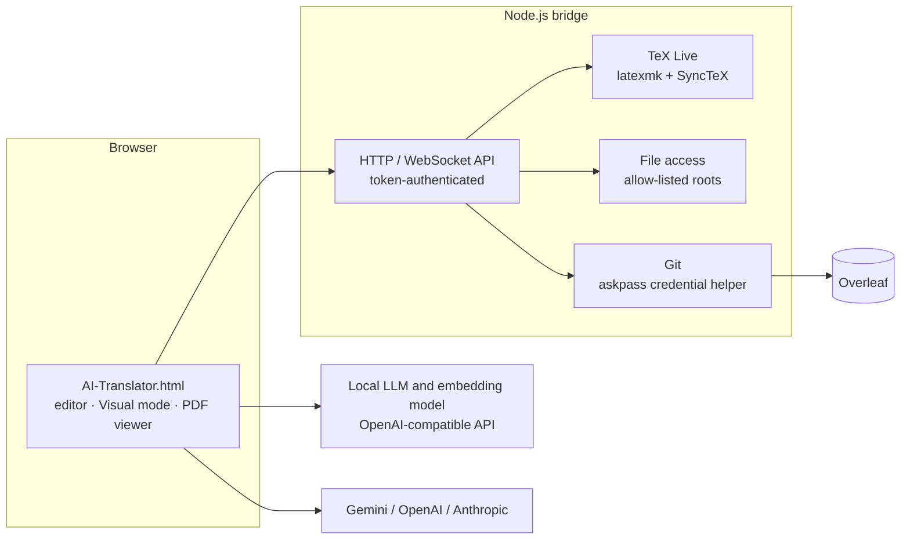

# Overleaf AI Translator

[](LICENSE)


Overleaf AI Translator is a translation workspace for LaTeX research papers,
integrated with Overleaf. It opens an Overleaf project, compiles it locally,
and shows the rendered paper with a translation beside every paragraph.
Mathematics, citations, cross-references, labels and color macros are
preserved, so the translated source still compiles. Translation runs on locally
hosted LLMs through any OpenAI-compatible endpoint, or on Google Gemini, OpenAI
and Anthropic models.

The project started from a written specification with strict invariants: the
paper must never be corrupted, and an edit must never be written to the wrong
place. AI coding agents, Claude Code and OpenAI Codex, carried out most of the
implementation under the author's direction. The author owned the
requirements, the architecture, the acceptance tests and the review of every
change. The dated Git history records this work.

## Two ways to run

| Mode | What runs | Requirements |
|---|---|---|
| **Translation only** | The single-file application in the browser. Text is translated by the selected model endpoint. | A browser and a model endpoint or API key |
| **Full workspace** | Adds the Node.js bridge: local LaTeX compilation, SyncTeX, project files, Overleaf Git synchronization and Visual mode. | Node.js, TeX Live with `latexmk`, Git |

The browser calls model endpoints directly; the bridge is not involved in
translation requests.

## What works

- Clone, pull and push of Overleaf projects through Overleaf's Git integration.
- Source editor with local compilation and an integrated PDF viewer.
- **Visual mode**: rendered sections, numbered equations, figures and tables, each shown with its translation.
- Equation numbering that follows LaTeX semantics for `\tag`, `\nonumber` and starred environments.
- SyncTeX navigation between the source, Visual mode and the PDF.
- In-place editing in Visual mode, written back to the matching range of the source.
- Placeholder protection for mathematics and LaTeX commands, with validation and staged retries.
- A per-project glossary and background card, sent with every translation request. Only the glossary entries that occur in a block are sent.
- Glossary matching that tolerates case, hyphenation, joined spellings, plural forms and acronym/full-form pairs.
- An optional translation memory based on retrieval-augmented generation. For each block, previously translated blocks of the same project are retrieved by hybrid search and supplied to the model as reference examples. The search combines BM25 with dense vectors from a local embedding model through reciprocal rank fusion. The memory is off by default; see [Verification](#verification).
- Terminology tools, all read-only until the user confirms a change:
  - a consistency check that lists blocks where a glossary term or an acronym is translated inconsistently;
  - glossary suggestions mined from the translation memory by source/target co-occurrence;
  - suggestions for source phrases that are semantically close to a glossary entry, found by embedding similarity and filtered by lexical and antonym guards.
- Optional modes that keep technical terms in English and that supply a domain hint for ambiguous terms.
- PDF-to-LaTeX conversion with a vision-language model.
- An AI assistant with tool access to the open project.
- An English or Chinese interface, selectable in Settings and remembered per browser.



## Quick start

**Translation only.** Open `AI-Translator.html` in Chrome or Edge, open
**Settings**, and choose a model. The local endpoint defaults to
`http://localhost:1234/v1`, the LM Studio default; hosted providers need an
API key.

**Full workspace.** Start the bridge:

```sh
cd tools/latex-bridge
npm install
export LATEX_BRIDGE_TEXBIN=/usr/local/texlive/2025/bin/x86_64-linux
export LATEX_BRIDGE_ALLOWED_ROOTS=$HOME/papers
node server.js
```

On Windows (PowerShell):

```powershell
cd tools\latex-bridge
npm install
$env:LATEX_BRIDGE_TEXBIN = "C:\texlive\2025\bin\windows"
$env:LATEX_BRIDGE_ALLOWED_ROOTS = "C:\papers"
node server.js
```

On first start, the bridge listens on `127.0.0.1:8181` and writes a random
access token to `tools/latex-bridge/.bridge-token`; enter this token in
**Settings**. To synchronize with Overleaf, create a Git authentication token
in Overleaf (**Account Settings → Git integration**) and enter it in the
application.

## Translation pipeline

```text
LaTeX source
  → segmentation into text blocks
  → placeholder masking of mathematics, \cite, \ref, \label, \textcolor, …
  → prompt assembly with glossary, background card and options
      ↳ optional: translation-memory retrieval (BM25 + embeddings, reciprocal rank fusion, relevance floor)
  → model request (local OpenAI-compatible endpoint or hosted provider)
  → placeholder validation (count and form)
      ↳ on mismatch: stricter instructions → lower placeholder density → sentence by sentence
  → unmasking and per-block caching
  → Visual mode rendering beside the original block
```

Each block is cached under a key derived from its source text and the
translation settings. A block whose source has not changed is not sent to the
model again.

## Safety rules

- Every placeholder must come back with the same count and form, or the response is rejected.
- Text that cannot be translated safely keeps its original wording and is flagged; nothing is dropped silently.
- An in-place edit is written only if the source range still matches what was rendered. Otherwise, the write is cancelled and the edited text is kept for recovery.
- Every bridge request must carry a random access token, and WebSocket connections use short-lived tickets.
- The bridge binds to `127.0.0.1` by default. For access from other devices, bind it to a private VPN address and never to `0.0.0.0`.
- File operations are limited to an explicit allow-list of directories.
- The Overleaf Git token is passed to Git through an askpass helper. It is never written into a remote URL or into the repository.
- Prompts sent to models are independent of the interface language.

## Architecture



| Component | Technology |
|---|---|
| Application | Single HTML file, vanilla JavaScript; Tailwind CSS, KaTeX, marked, PDF.js |
| Bridge | Node.js `http` and `ws` |
| Compilation | TeX Live, `latexmk`, SyncTeX |
| Synchronization | Overleaf Git integration |
| Models | Any OpenAI-compatible API (e.g. LM Studio), Google Gemini, OpenAI, Anthropic |
| Retrieval | BM25 and dense embeddings (Qwen3-Embedding-0.6B by default) fused by reciprocal rank fusion; vectors cached in IndexedDB |
| Languages | Multiple languages (currently Chinese and English) |

## Verification

Changes are developed one feature per Git worktree. They are verified by an
end-to-end suite of more than 200 scenario scripts that drive headless Chrome
through the DevTools Protocol against a test bridge. The suite:
- checks invariants across reloads, re-renders and real window resizes, not only end states;
- uses mutation checks to confirm that each test fails when the code it covers is broken;
- validates model-facing behavior against recorded responses from real local models.

The suite runs on a dedicated test machine and is not included in this
repository, because its fixtures are private.

Most recent results:

| Date | Suite | Result |
|---|---|---|
| 2026-10-22 | Terminology mode and its settings migration | 48 passed, 0 failed |
| 2026-10-24 | Interface language selection and persistence; user content never translated | 24 passed, 0 failed |
| 2026-10-24 | Translation memory: retrieval, relevance floor, embedding fallback, byte-identical requests when off | 70 passed, 0 failed |
| 2026-10-24 | Normalized glossary matching | 55 passed, 0 failed |
| 2026-10-24 | Terminology consistency check, including 500 blocks × 300 entries in under 1.5 s | 30 passed, 0 failed |
| 2026-10-24 | Glossary suggestions mined from the translation memory | 42 passed, 0 failed |
| 2026-10-24 | Similar-term suggestions with lexical, sibling and antonym guards | 42 passed, 0 failed |

Each new suite was also run against the build before the feature, where its
feature checks fail, and mutation runs confirmed that removing a guard turns
the corresponding checks red. With all features idle, translation requests
were compared byte for byte against the previous build.

The similar-term threshold was calibrated against a local embedding model. The
calibration set was a held-out list of synonym, sibling and antonym term pairs,
and the chosen threshold gives a precision of about 0.9.

Local translation models were selected by blind pairwise comparison on
real-world LaTeX documents, with accuracy and terminology judged separately.

### Translation-memory evaluation

**Embedding model.** Four open embedding models were compared on a retrieval
benchmark built from real-world LaTeX documents: BGE-M3, Qwen3-Embedding-0.6B,
multilingual-e5-large-instruct and nomic-embed-text-v1.5. The benchmark used
Recall@4, MRR@10 and nDCG@10 for English and Chinese queries, and also measured
throughput. Qwen3-Embedding-0.6B gave the best overall balance of quality and
speed, and is the default.

**End-to-end effect.** The translation memory was then tested on 20 blocks
from three real-world LaTeX documents. Each block was translated with the
memory on and off, in two settings: an empty glossary, and a glossary with a
background card. An LLM judge received a reference translation and the two
candidates in shuffled order. It ranked the candidates and scored accuracy
and terminology separately on a 1–5 scale.

| Setting | Memory on preferred | Memory off preferred | Accuracy (on / off) | Terminology (on / off) |
|---|---|---|---|---|
| Empty glossary | 9 | 11 | 4.25 / 4.40 | 3.70 / 3.90 |
| Glossary and background card | 9 | 11 | 4.50 / 4.35 | 4.30 / 4.60 |

No difference is statistically significant (two-sided sign test, p = 0.82 for
the preference counts in each setting). Retrieval worked as designed: every
evaluated block received retrieved examples (3.8 on average) that passed the
relevance floor, and no example was dropped by the leak guard. However, the retrieved examples are the model's own earlier
translations, and the judge's notes show some of their mistranslations being
reused. The memory therefore ships disabled by default. Retrieval restricted to
translations that the user has edited or confirmed is planned.

## Configuration

| Variable | Description | Default |
|---|---|---|
| `LATEX_BRIDGE_TEXBIN` | TeX Live `bin` directory | required for compilation |
| `LATEX_BRIDGE_ALLOWED_ROOTS` | Directories the bridge may access | none |
| `LATEX_BRIDGE_HOST` | Bind address | `127.0.0.1` |
| `LATEX_BRIDGE_PORT` | Port | `8181` |
| `LATEX_BRIDGE_TOKEN` | Access token. If unset, it is read from or generated in `.bridge-token`. | generated |

## Repository layout

- `AI-Translator.html`: the application, as a single file.
- `VERSION`: the release version, stamped into the application at commit time.
- `tools/latex-bridge/`: the Node.js bridge for compilation, file access and Overleaf Git.
- `docs/screenshots/`: images used in this README.

## Secrets

Never commit `tools/latex-bridge/.bridge-token`, Overleaf Git tokens or model
API keys. The bridge token file is listed in `.gitignore`. Model API keys are
entered in the application's settings and stored in the browser.

## Limitations

- Prompts are currently tuned for Chinese and English. Support for further languages is planned.
- The translation memory retrieves earlier machine translations that no one has reviewed, and it did not measurably improve quality in the evaluation above.
- Embedding features (the translation memory and similar-term suggestions) need a local OpenAI-compatible `/v1/embeddings` endpoint. Without one, the translation memory falls back to BM25 retrieval.
- Compilation targets TeX Live with `latexmk`.
- Models are called directly from the browser, so a hosted provider that blocks cross-origin requests needs a proxy.
- The earlier multi-file version of this project is preserved at tag [`v1`](../../tree/v1) and is no longer maintained.

## License, commercial use, and brand

The original source code of Overleaf AI Translator is Copyright (C) 2025-2026
Xiaofan Liu and is licensed under **AGPL-3.0-only**. Anyone who operates a
modified version over a network must provide the corresponding source, as the
license requires. Organizations that need proprietary terms can request a
separate commercial license.

Screenshots under `docs/screenshots/` are excluded from the software license
and remain all rights reserved. So are the project's name, logos and
distinctive brand identity. "Overleaf" is a trademark of its respective owner;
this project is not affiliated with or endorsed by Overleaf or Digital Science.
Third-party components keep their own licenses.

See [`LICENSE`](LICENSE), [`LICENSING.md`](LICENSING.md),
[`TRADEMARKS.md`](TRADEMARKS.md) and [`NOTICE`](NOTICE) for the complete
licensing boundaries.
