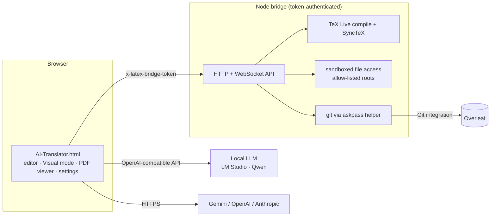

# Overleaf AI Translator

**A multilingual translator for LaTeX research papers, built around Overleaf.** It opens an Overleaf project, renders the paper, and shows a translation next to every paragraph. Equations, citations, labels and color macros come through intact, so the translated text still compiles.

The LaTeX protection, glossary and Visual mode do not depend on the language pair, but prompts are currently tuned for Chinese. **English ↔ Chinese is fully supported today; other language pairs are planned.**

I built it for my own PhD writing. It runs on local LLMs (any OpenAI-compatible server such as LM Studio) as well as hosted models (Gemini, OpenAI, Anthropic), and I use it every day.

## At a glance

| | |
|---|---|
| Frontend | one HTML file, ~73k lines of vanilla JS (Tailwind CDN, KaTeX, marked), no build step |
| Backend | Node.js bridge, ~4.5k lines (`http` + `ws`): LaTeX compilation, sandboxed file access, Overleaf Git |
| Languages | English ↔ Chinese today; more language pairs planned (UI currently in Chinese) |
| Models | any OpenAI-compatible endpoint (LM Studio / Qwen on 2× RTX A6000), Gemini, OpenAI, Anthropic |
| Development | ~480 published commits (~600 in the private repo), Dec 2025 – Oct 2026, mostly Aug–Oct 2026 |
| Tests | ~220 end-to-end test scripts: headless Chrome over CDP, run on a separate test machine |

## Features

**Translation that respects LaTeX**
- Math, `\cite`, `\ref`, `\label`, `\textcolor` and other commands are masked before translation and restored afterwards. If the model alters a placeholder, the block is retried with stricter instructions, then sentence by sentence. Anything that still fails keeps the original text and is flagged.
- A **glossary** and a **background card** for each paper (a short description of its field and contributions) go into every prompt, so terminology stays consistent across the whole paper.
- Optional **keep technical terms in English** mode, for method names, model names and established acronyms.
- A one-line **domain hint** helps the model choose the right sense of ambiguous words.

**Overleaf workflow**
- Clone, pull and push Overleaf projects through Overleaf's Git integration.
- LaTeX editor with local compilation and a PDF preview. SyncTeX connects source, rendered view and PDF in both directions.
- **Visual mode** renders sections, numbered equations (following LaTeX's rules for `\tag`, `\nonumber` and starred environments), figures and tables, with the translation beside each block. You can edit text directly in the visual view, and the change is written back to its exact source location.
- PDF → LaTeX conversion with a vision model, for papers that only exist as PDF.
- An AI assistant panel that can read the open project and act on it.

## Architecture



## Engineering notes

Some of the problems that took the most work:

- **Not breaking the paper.** LaTeX mixed into prose is fragile, and small local models lose placeholders deterministically in dense passages. Each block is masked and translated. The returned placeholders must match in number and shape; if they don't, a retry ladder kicks in: re-prompt with different instructions, then lower the placeholder density, then translate sentence by sentence. Sentences that still fail keep the original text and are reported, never silently dropped.
- **Writing back to the right place.** The visual view is a rendering, but edits must land in the `.tex` source. Every rendered block keeps its source range. Before an in-place edit is written, the app checks that the source at that range still matches what was rendered. If the file changed in the meantime, the write is cancelled and the typed text is offered for recovery instead of landing on the wrong lines.
- **Performance on long documents.** A long document with a warm translation cache once froze the page for many seconds. The first reproduction used an empty profile and only found a secondary cause. The real cause appeared only with production-sized cached state: the whole cache bucket was parsed on every access, and stale entries were rewritten block by block. Since then, performance bugs are always reproduced with realistic state.
- **Security of a local bridge.** The bridge can read and write files and run git, so it is locked down: a random access token on every request, short-lived WebSocket tickets, loopback-only binding by default (or a specific VPN address, never `0.0.0.0`), and an explicit directory allow-list. The Overleaf Git token is handed to git through an askpass helper. It never appears in a remote URL or on disk in the repository.
- **Choosing a model with evidence.** Candidate local models were compared in blind pairwise evaluations on real-world LaTeX documents, judged separately for accuracy and terminology, before switching the default model. Wins on synthetic test sentences did not always hold up on real-world documents.
- **Testing a 73k-line single-file app.** Most bugs were state bugs: something looked right on first render and was wrong after a reload or a resize. So the end-to-end tests assert invariants across re-renders and real window resizes, not just the final state. Mutation checks confirm that each test actually fails when the code it guards is broken.

## How it was built

I developed this project with AI coding agents (Claude Code and OpenAI Codex) doing most of the implementation. My part was the product and the engineering process:
- defining requirements and the architecture;
- splitting work into small, reviewable passes, each in its own git worktree;
- designing the acceptance tests and invariants;
- reviewing and merging changes;
- deploying to a lab server;
- validating results on real-world documents.

Most commits carry a `Co-Authored-By` trailer for that reason. The commit history is the real development history, filtered down to the published files. Commit messages were originally written in Chinese and have been replaced with English summaries. Work items are numbered as passes (`P123:`).

The single-file design is deliberate: the app opens from disk or any static server with zero setup. The cost is a very large file, which the test suite and per-feature worktrees keep manageable.

## Quick start

1. **Translation only:** open `AI-Translator.html` in Chrome or Edge, open Settings, and choose a model:
   - local: an OpenAI-compatible endpoint, e.g. LM Studio's `http://localhost:1234/v1`;
   - hosted: paste a Gemini, OpenAI or Anthropic API key.

   Local endpoints default to `localhost` (LM Studio on port 1234, bridge on 8181); change them in Settings if your servers run elsewhere.

2. **Overleaf + compilation + Visual mode:** start the bridge.

   ```sh
   cd tools/latex-bridge
   npm install
   # Windows example; adjust paths for your machine
   set LATEX_BRIDGE_TEXBIN=C:\texlive\2025\bin\windows
   set LATEX_BRIDGE_ALLOWED_ROOTS=C:\path\to\your\projects
   node server.js
   ```

   On first start the bridge listens on `127.0.0.1:8181` and writes a random access token to `tools/latex-bridge/.bridge-token`. Paste that token into the app's Settings. For Overleaf sync, create a Git token in Overleaf (Account Settings → Git integration) and enter it in the app.

   | Variable | Purpose | Default |
   |---|---|---|
   | `LATEX_BRIDGE_HOST` | bind address; use a VPN/Tailscale IP for multi-device use, never `0.0.0.0` | `127.0.0.1` |
   | `LATEX_BRIDGE_PORT` | port | `8181` |
   | `LATEX_BRIDGE_TOKEN` | access token (otherwise read from or created in `.bridge-token`) | generated |
   | `LATEX_BRIDGE_TEXBIN` | TeX Live `bin` directory | `E:\texlive\2025\bin\windows` |
   | `LATEX_BRIDGE_ALLOWED_ROOTS` | directories the bridge may read and write | — |

## Repository layout

```
AI-Translator.html        the whole app
VERSION                   version number, stamped into the HTML by a pre-commit hook
tools/latex-bridge/       Node bridge: compilation, file access, Overleaf git
```

The end-to-end test suite is not published.

## Status

This is a personal research tool under active development. The earlier multi-file version is available at the tag [`v1`](../../tree/v1).
