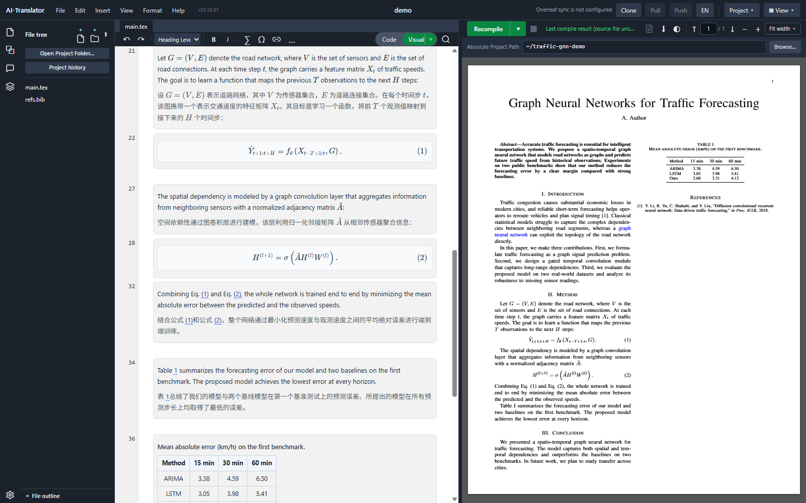
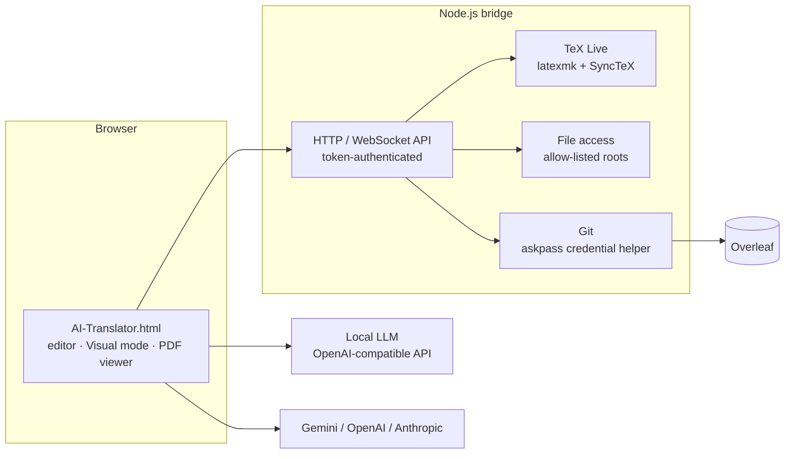

# Overleaf AI Translator

A multilingual translation workspace for LaTeX research papers, integrated with Overleaf.

Overleaf AI Translator opens an Overleaf project, compiles it locally, and renders each paragraph next to its translation. Mathematics, citations, cross-references, labels and color macros are preserved, so the translated source still compiles. It works with locally hosted LLMs through any OpenAI-compatible endpoint, as well as with Gemini, OpenAI and Anthropic models.

The application is a single HTML file and needs no build step. An optional Node.js bridge adds LaTeX compilation, file access and Overleaf Git synchronization.



## Overview

| | |
|---|---|
| Languages | Multiple languages (currently Chinese and English) |
| Interface | English and Chinese, switchable in Settings (English by default) |
| Models | Local LLMs via any OpenAI-compatible API (e.g. LM Studio), Google Gemini, OpenAI, Anthropic |
| Frontend | Single-file web application in vanilla JavaScript, with Tailwind CSS, KaTeX, marked and PDF.js |
| Backend | Node.js bridge (`http` + `ws`) for compilation, file access and Git |
| Integrations | Overleaf Git integration, TeX Live (`latexmk` + SyncTeX) |

## Features

### LaTeX-aware translation
- Mathematics, `\cite`, `\ref`, `\label`, `\textcolor` and other commands are replaced with placeholders before translation and restored afterwards.
- Placeholders returned by the model are validated by count and form. If they do not match, the request is retried in three stages:
  1. with stricter instructions;
  2. with fewer placeholders per request;
  3. sentence by sentence.

  Text that still cannot be translated safely keeps its original wording and is flagged; nothing is dropped silently.
- A per-project glossary and a background card (the field, problem and contributions of the paper) are sent with every request, which keeps terminology consistent across the document.
- Optional modes keep technical terms in English (method and model names, established acronyms) and add a domain hint for resolving ambiguous terms.

### Overleaf workflow
- Clone, pull and push Overleaf projects through Overleaf's Git integration.
- Source editor with local compilation and an integrated PDF viewer.
- **Visual mode**: rendered sections, numbered equations, figures and tables, each shown with its translation. Equation numbering follows LaTeX semantics for `\tag`, `\nonumber` and starred environments.
- SyncTeX-based navigation between the source, Visual mode and the PDF.
- In-place editing in Visual mode, written back to the corresponding range of the source.
- PDF-to-LaTeX conversion with a vision-language model, for documents that exist only as PDF.
- An AI assistant with tool access to the open project.

## Architecture



The browser calls model endpoints directly. The bridge is needed only for compilation, project files and Overleaf synchronization; translating pasted text works without it.

## Design

**Placeholder integrity.** Smaller local models tend to drop or rewrite placeholders in passages dense with inline mathematics. The validate-and-retry sequence described above limits such failures to individual sentences rather than whole paragraphs, and every remaining failure is shown to the user.

**Safe write-back.** Each block rendered in Visual mode records its range in the source file. Before an in-place edit is applied, the application checks that the source in that range has not changed since rendering. If it has, the write is cancelled and the edited text is kept for recovery, so an edit cannot be applied to the wrong lines.

**Performance on long documents.** Translations are cached per block. An earlier design parsed the whole cache and rewrote stale entries on every load, which stalled the page on long documents. Cache access was redesigned to avoid both. Performance issues are reproduced with production-sized cached state, because an empty profile hides this class of problem.

**Bridge security.** The bridge can read and write files and run Git, so:
- every request must carry a random access token;
- WebSocket connections use short-lived tickets;
- the server binds to `127.0.0.1` by default;
- file operations are restricted to an explicit allow-list of directories.

The Overleaf Git token is passed to Git through an askpass helper. It is never written into a remote URL or into the repository.

**Model selection.** Local translation models were selected by blind pairwise comparison on real-world LaTeX documents, with accuracy and terminology judged separately.

## Requirements

- A Chromium-based browser (Chrome or Edge).
- For translation: an OpenAI-compatible LLM endpoint, or an API key for Gemini, OpenAI or Anthropic.
- For compilation and Overleaf synchronization: Node.js (LTS), TeX Live with `latexmk`, and Git.

## Getting started

### Translation only

Open `AI-Translator.html` in the browser, open **Settings** and choose a model. The local endpoint defaults to `http://localhost:1234/v1`, the LM Studio default.

### With the bridge

```sh
cd tools/latex-bridge
npm install

# macOS / Linux
export LATEX_BRIDGE_TEXBIN=/usr/local/texlive/2025/bin/x86_64-linux
export LATEX_BRIDGE_ALLOWED_ROOTS=$HOME/papers
node server.js
```

```powershell
# Windows (PowerShell)
$env:LATEX_BRIDGE_TEXBIN = "C:\texlive\2025\bin\windows"
$env:LATEX_BRIDGE_ALLOWED_ROOTS = "C:\papers"
node server.js
```

On first start, the bridge listens on `127.0.0.1:8181` and writes a random access token to `tools/latex-bridge/.bridge-token`; enter this token in **Settings**. To synchronize with Overleaf, create a Git authentication token in Overleaf (**Account Settings → Git integration**) and enter it in the application.

### Configuration

| Variable | Description | Default |
|---|---|---|
| `LATEX_BRIDGE_TEXBIN` | TeX Live `bin` directory | required for compilation |
| `LATEX_BRIDGE_ALLOWED_ROOTS` | Directories the bridge may access | none |
| `LATEX_BRIDGE_HOST` | Bind address. For access from other devices, bind to a private VPN address; never use `0.0.0.0`. | `127.0.0.1` |
| `LATEX_BRIDGE_PORT` | Port | `8181` |
| `LATEX_BRIDGE_TOKEN` | Access token. If unset, it is read from or generated in `.bridge-token`. | generated |

## Repository layout

```
AI-Translator.html      application (single file)
VERSION                 release version, stamped into the application at commit time
tools/latex-bridge/     Node.js bridge: compilation, file access, Overleaf Git
docs/screenshots/       images used in this README
```

## Development

Most of the implementation was written by AI coding agents (Claude Code and OpenAI Codex). The author:
- defined the requirements and architecture;
- divided the work into small, independently reviewed passes;
- designed the acceptance tests;
- reviewed and validated every change.

Commits produced this way carry a `Co-Authored-By` trailer, and commit subjects are numbered by pass (`P123:`).

Each feature is developed in its own Git worktree. Changes are verified with an end-to-end suite of more than 200 scenario scripts that drive headless Chrome through the DevTools Protocol. The suite checks invariants across reloads, re-renders and window resizes, and mutation checks confirm that each test fails when the code it covers is broken. The suite is not included in this repository.

The application ships as a single file so that it runs from a local disk or any static host without installation.

## Limitations

- Prompts are currently tuned for Chinese and English; support for further languages is planned.
- Compilation targets TeX Live with `latexmk`.
- Models are called directly from the browser, so a hosted provider that does not allow cross-origin requests needs a proxy.

## Disclaimer

This project is not affiliated with or endorsed by Overleaf or Digital Science. Overleaf is a trademark of its respective owner.

The earlier multi-file version of this project is available at tag [`v1`](../../tree/v1).
